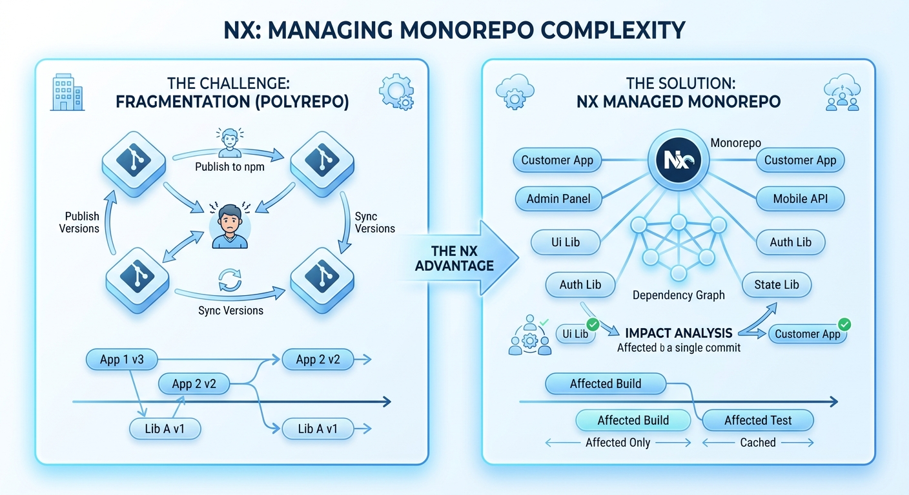
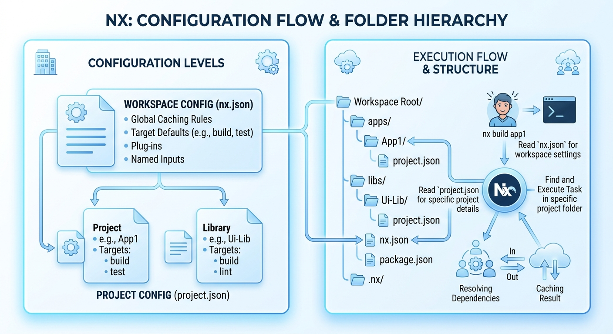
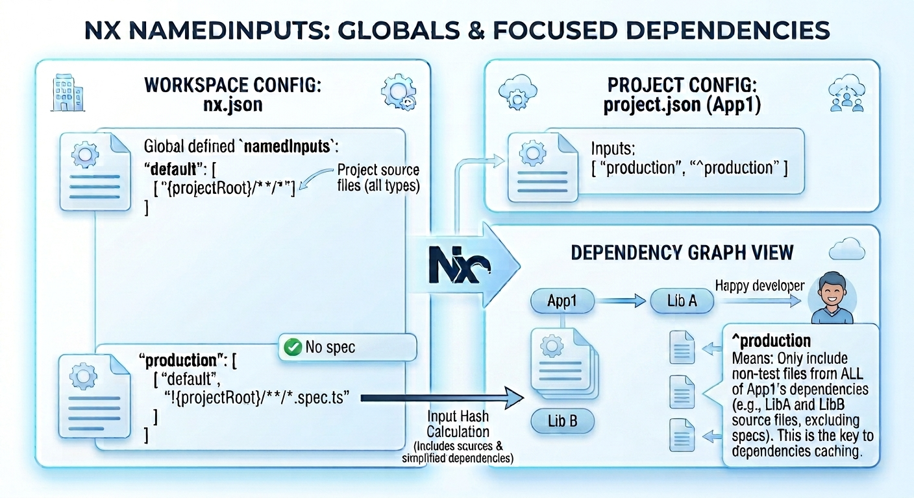
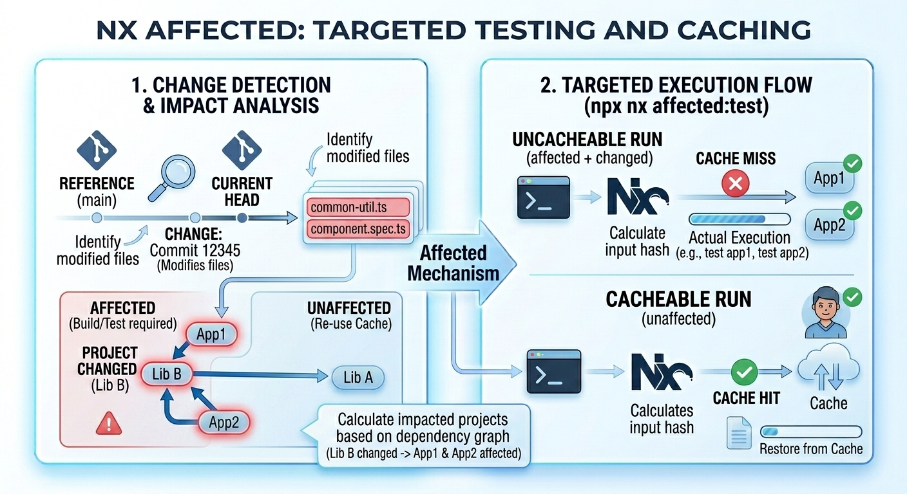
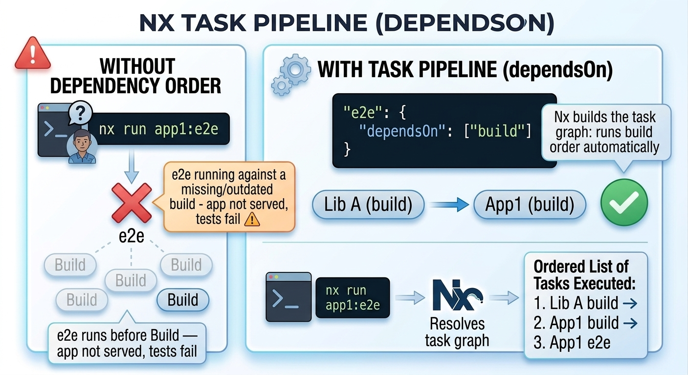

# Nx fundamentals

With multiple repos (polyrepo), sharing code between projects means publishing packages and manually syncing versions across repos — slow and error-prone. A monorepo avoids that by keeping all projects in one place, but at scale it raises a new problem: how to know what a change actually affects, and how to avoid rebuilding/retesting everything on every commit. Nx was created to solve this by building a dependency graph of the monorepo and only building, testing, and caching what's actually affected by a change.

## Key concepts

### Structure

A workspace is organized as a root folder with `apps/` and `libs/` holding each project, a root `nx.json` for global settings (caching rules, target defaults, plugins), and a `.nx/` folder used as the local cache. Each project (app or lib) has its own `project.json` defining its targets (e.g. build, test) — running a command reads `nx.json` for workspace-wide settings, then that project's `project.json` to find and execute the right task.

### Cache

Before running a task, Nx computes a hash from the relevant inputs — the project's source files plus the same "production" files from its dependencies (via `^production`, excluding tests) — as defined by `namedInputs` in `nx.json`. If that hash was already seen, Nx replays the cached output instead of re-running the task, which is why only what actually changed (directly or through a dependency) triggers real work.

### Affected

`nx affected` compares the current changes against a reference commit (e.g. `main`) to list the modified files, then walks the dependency graph to find every project impacted by those changes — not just the ones directly edited, but also anything that depends on them (e.g. a change in `Lib B` also marks `App1` and `App2` as affected). Running a command like `nx affected:test` then only targets those projects instead of the whole workspace. Since the affected set is recomputed against the reference branch on every run, the same project can stay "affected" across several runs while you keep iterating — the cache is what makes that cheap: a project only gets rebuilt if its own inputs changed since its last execution, so re-running the command after touching just one more file only triggers real work for the projects impacted by that new change.

### Task pipeline

Some tasks genuinely need another task to run first — an `e2e` run needs `app1` to be built (and served) beforehand (unlike `test`, which typically runs straight against the source via TS path mappings, no build required). Declaring `"e2e": { "dependsOn": ["build"] }` tells Nx to resolve a task graph instead of running the task in isolation: running `nx run app1:e2e` then executes `Lib A build` → `App1 build` → `App1 e2e`, in the right order, automatically.

The two mechanisms are complementary: the task pipeline always resolves dependencies in the correct order, while the cache decides which of those steps actually need to re-run.
